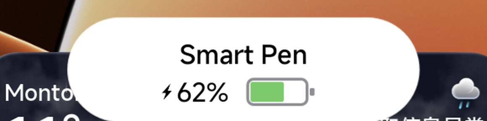
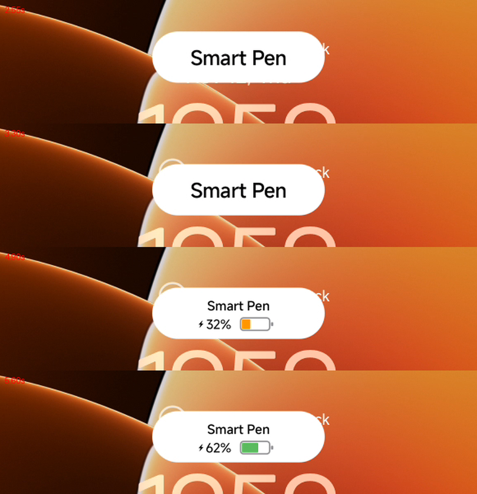

# Smart Pen Charge HUD — Xiaomi tablets

> [!WARNING]
> **Root module. Read [SAFETY.md](SAFETY.md) first.**
> It replaces a system app (`SecurityCoreAdd.apk`) and a system config file.
> On an unsupported ROM it can leave you without the stylus popup, with a broken
> `com.miui.securitycore`, or with a device that does not finish booting.
> Everything here is provided **as is, without any warranty** (MIT).
> You patch **your own** APK, you sign it with **your own** key, you flash it at **your own risk**.

Replaces the Xiaomi stylus charging bubble (the little "battery + %" popup) with an animated
**Smart Pen** HUD **inspired by the iPadOS Apple Pencil charging overlay**: a white tile
dropping in from the real top edge of the screen, the title shrinking, a hand-drawn Xiaomi pen
gauge (grey shell, fully rounded fill, thin nub) and a ~0.6 s charge fill animation.



<p align="center">
  
</p>

## What it changes

- **Entry** — the tile slides in from the actual top edge of the display (damped spring, 680 ms), opaque.
- **Compaction** — "Smart Pen" shrinks and the `⚡ 62 % [gauge]` row fades in.
- **Gauge** — drawn by hand, no assets: HSL colour ramp red → orange → green, fill in
  `260 ms + 5 ms per percent` (~0.57 s at 62 %).
- **Exit** — the tile slides back out through the top edge by moving inside an
  already-expanded window, so no WindowManager transaction happens per frame (no dropped frame).
- **No blur** — the window is forced `OPAQUE`, window blur/private flags are cleared,
  and the tile has no drop shadow: no halo and no blurred band at the screen edge.

## How it works

The module replaces a single file: `SecurityCoreAdd.apk`
(`/system/product/app/SecurityCoreAdd/`). The dex patch touches only two things:

1. `com.miui.miinput.stylus.battery.MiuiStylusLevelsView` is **rewritten**. Its public API is
   tiny — `<init>(Context, AttributeSet)`, `setElectricity(int)`, `onDraw(Canvas)` — so a drop-in
   replacement is safe as long as the caller only uses those.
2. The smali that builds the `StylusBattery` window is retouched on four `LayoutParams` values:

   | field | before | after | effect |
   |---|---|---|---|
   | `windowAnimations` | MIUI style | `0` | no system window animation |
   | `format` | `-3` (TRANSLUCENT) | `1` (OPAQUE) | removes the blur |
   | `privateFlags` | `\| 0x2` | `\| 0x0` | removes the blur flag |
   | dwell constant | `0x7d0` (2 s) | `0x2328` (9 s) | gives the animation time |

The patcher is **anchored on the `LayoutParams` field names**, not on offsets or file names,
so it finds the obfuscated class by itself (`u2.1/e.smali` on the tested ROM) even if its name
changes between builds.

## Compatibility

**Tested on**: Xiaomi Pad 6 (codename `pipa`, model `23043RP34C`), HyperOS
`OS4.0.0.37.XPZCNXM`, `SecurityCoreAdd` versionName `4.4.3.4-4-260814.pad`.

**It will not work out of the box on every Xiaomi tablet.** The patch assumes:

1. `SecurityCoreAdd` still contains `MiuiStylusLevelsView` with `setElectricity(int)`;
2. the `StylusBattery` window still has `windowAnimations` / `format` / `privateFlags`
   and a 2 s dwell (`0x7d0`);
3. you sign with the same key as the original APK (otherwise PackageManager rejects the update).

Check before patching anything — the dry run verifies every anchor and changes nothing:

```bash
./tools/apply.sh --apk ~/SecurityCoreAdd.apk --dry-run
```

```
[ok] class replaced   : com/miui/miinput/stylus/battery/MiuiStylusLevelsView.smali
[ok] window found     : smali/u2.1/e.smali
[ok] windowAnimations : 0x7f140717 -> 0x0
[ok] format           : -0x3 -> 0x1 (OPAQUE)
[ok] privateFlags     : blur flag removed
[ok] dwell            : 0x7d0 (2 s) -> 0x2328 (9 s)
```

If an anchor is missing, the script stops and names it — the ROM needs an adaptation
(usually one or two lines in `tools/patch_smali.py`).

Resource IDs are resolved **by name** first (`ic_stylus_in_charging`) with a baked fallback,
so a ROM with different IDs will not crash the HUD.

### Hidden API whitelist

The module ships `system/etc/sysconfig/hiddenapi-package-whitelist.xml`: the AOSP file
**plus one line** for `com.miui.securitycore`. The APK you sign is no longer platform-signed,
so it loses the hidden-API exemption, and without this line the HUD can fail to appear.

It **overrides** the ROM's file. If your ROM's copy differs, merge the line into your own file
instead of using ours:

```xml
<hidden-api-whitelisted-app package="com.miui.securitycore" />
```

`--no-whitelist` skips it, but the HUD may then stay invisible (unverified).

## Requirements

- rooted Xiaomi tablet (KernelSU, KernelSU-Next, APatch or Magisk);
- `java`, `apktool`, `python3`, `zip`/`unzip`;
- Android build-tools for `zipalign` and `apksigner`
  (`export ANDROID_BUILD_TOOLS=$HOME/Android/Sdk/build-tools/36.0.0`);
- the **original** `SecurityCoreAdd.apk` from your ROM;
- a signing key the system accepts (usually your ROM's `platform` key, or the AOSP test keys
  if your build uses them).

## Usage

```bash
# 1. pull the APK from your tablet (needs root)
./tools/extract_from_device.sh "$(adb get-serialno)" ./SecurityCoreAdd.apk

# 2. check compatibility (nothing is modified)
./tools/apply.sh --apk ./SecurityCoreAdd.apk --dry-run

# 3. build the patched APK + the module
./tools/apply.sh --apk ./SecurityCoreAdd.apk \
                 --key ./platform.pk8 --cert ./platform.x509.pem \
                 --version v1

# 4. install and reboot
adb push out/*.zip /data/local/tmp/
adb shell su -c 'ksud module install /data/local/tmp/'"$(ls out/*.zip | xargs basename)"
adb reboot
```

`apply.sh` prints both certificates: if your key is not the one that signed the original APK,
it warns loudly (a signature mismatch is the most common way to break the app). Add
`--require-same-key` to make that mismatch fatal.

Trigger the HUD without waiting for the stylus:

```bash
adb shell su -c 'am broadcast -n com.miui.securitycore/com.miui.miinput.stylus.MiuiStylusReceiver \
  -a com.android.settings.stylus.STYLUS_STATE_SOC \
  --ei battery 62 --ei state 4 --ei connect 5 --es source bluetooth'
```

## Animation tuning

All timings are constants at the top of `src/.../MiuiStylusLevelsView.java`:

```java
DROP_MS = 680;          // entry drop (damped spring)
FADE_MS = 70;           // reveal fade
DROP_HOLD_MS = 1500;    // full tile hold
COMPACT_MS = 740;       // title shrink
COMPACT_HOLD_MS = 820;  // pause before the fill
HOLD_MS = 1400;         // hold at 62 %
OUT_MS = 520;           // exit
REST_LIFT_DP = 6;       // resting height (higher = shorter drop)

final float fillDur = 260f + targetLevel * 5f;   // gauge fill
```

## Uninstall / rollback

```bash
adb shell su -c 'ksud module uninstall smartpen_charge_hud'
adb reboot
```

If the device does not boot, see [SAFETY.md](SAFETY.md).

## Legal

- No Xiaomi files are distributed here: no APK, no resources, no decompiled dex.
  You patch the APK extracted from **your own** ROM.
- **Do not redistribute** `out/SecurityCoreAdd-patched.apk`: it is a derivative of a
  proprietary application. Share the script, not the binary.
- **Never publish** your `platform.pk8`: it signs every system APK of your ROM.
- The hidden-API whitelist shipped here is the AOSP file (Apache-2.0) plus one line.

## Built with AI

Most of the code and documentation here was written with AI assistants, then tested on a real
device:

- **Claude (Anthropic)** — first versions of the HUD, the dex-patch pipeline, the window
  expansion trick and the animation curve tuning;
- **DeepSeek (V4.1 Flash)** — later iterations: faster gauge fill (~0.6 s), higher resting
  position, and the packaging of this repository (anchor-based patcher, `--dry-run`,
  `SAFETY.md`, English docs).

Design choices, screenshots, on-device testing and every "does it look right?" decision were
made by the maintainer on a Xiaomi Pad 6. AI assistants are tools, not authors: the person who
publishes and supports this repo remains responsible for what it does — hence the MIT license
and the warnings in [SAFETY.md](SAFETY.md). Details in [AUTHORS.md](AUTHORS.md).

## Credits / inspiration

- The interaction and the look are **inspired by the iPadOS Apple Pencil charging HUD**
  (a pill that slides down from the top edge, shows the pen and its battery, then leaves).
  This project only borrows the *idea*: no Apple asset, font, colour file or code is used.
  Everything is drawn at runtime or taken from the Xiaomi app already installed on the device.
- Gauge geometry follows a personal HTML/CSS mock-up; the pen shell, the rounded fill and the
  nub are drawn by hand in `onDraw`.
- Typography is MiSans (the HyperOS system font), not SF.
- Not affiliated with, endorsed by, or supported by Xiaomi or Apple.

## License

MIT for the code in this repository — see [LICENSE](LICENSE).